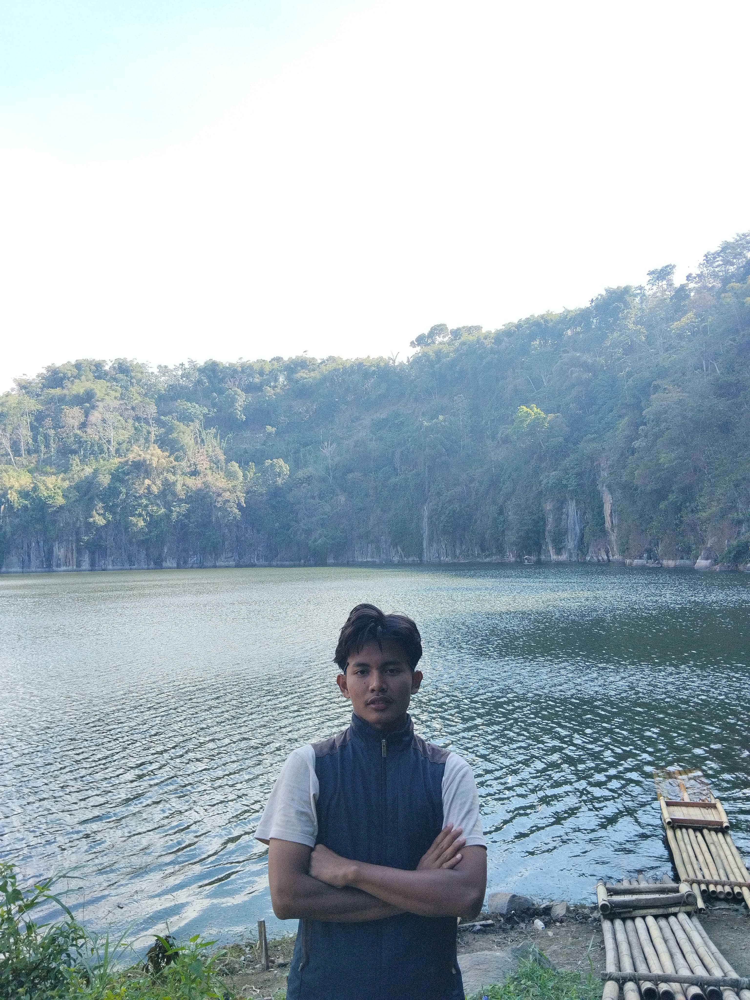

<!-- ======================= HERO / HEADER ======================= -->

  

  

   

  
  
  

 

<!-- ======================= NAVIGASI ======================= -->

  [**🧑‍🚀 Misi**](#-briefing-misi) &nbsp;•&nbsp;
  [**🛠️ Peralatan**](#️-peralatan-kru) &nbsp;•&nbsp;
  [**📊 Telemetri**](#-telemetri-github) &nbsp;•&nbsp;
  [**🪐 Proyek**](#-log-misi-proyek) &nbsp;•&nbsp;
  [**📡 Kontak**](#-buka-saluran-komunikasi)

<!-- ======================= TENTANG SAYA ======================= -->
## 🧑‍🚀 Briefing Misi

<table align="center">
  <tr>
    <td align="center" valign="middle" width="30%">
      
        
      <b>COMMANDER AREY</b> 
      <code>ID: areybra</code>
    </td>
    <td align="center" valign="middle" width="70%">
      
    </td>
  </tr>
</table>

<!-- ======================= TEKNOLOGI & TOOLS ======================= -->
## 🛠️ Peralatan Kru

  
   
  <i>Setiap planet adalah teknologi yang mengorbit di sekitar inti: <b>kode</b>.</i>

 

| 🌐 Frontend | ⚙️ Backend & Data | 🎨 Desain & Workflow |
| :---: | :---: | :---: |
| HTML5 · CSS3 · JavaScript | PHP · Python · MySQL | Figma · Git · GitHub |
| Antarmuka responsif & interaktif | Logika aplikasi, otomasi & data | Prototype, versioning & kolaborasi |

<!-- ======================= STATISTIK GITHUB ======================= -->
## 📊 Telemetri GitHub

  <table>
    <tr>
      <td align="center" width="50%">
        
      </td>
      <td align="center" width="50%">
        
      </td>
    </tr>
  </table>

  

<!-- ======================= PROYEK ======================= -->
## 🪐 Log Misi (Proyek)

<!--
  CARA MENGISI:
  Ganti NAMA_REPO_1 dan NAMA_REPO_2 dengan nama repositori kamu.
  Tambah baris <td> baru bila ingin menampilkan lebih banyak proyek.
-->

  <table>
    <tr>
      <td align="center" width="50%">
        
      </td>
      <td align="center" width="50%">
        
      </td>
    </tr>
  </table>

<!-- ======================= HUBUNGI SAYA ======================= -->
## 📡 Buka Saluran Komunikasi

  <em>Terbuka untuk diskusi, kolaborasi proyek, atau sekadar ngobrol soal kode. Kirim sinyal kapan saja — transmisi akan dibalas secepatnya. 🛰️</em>

  
  
  
  

<!-- ======================= FOOTER ======================= -->

   

  <em>"Code is like humor. When you have to explain it, it's bad."</em> – Cory House

    

  <b>⭐ Jangan lupa beri bintang pada repositori yang bermanfaat! ⭐</b>

   

  Dibuat dengan ❤️ dan banyak kopi oleh <b>Arey</b> • © 2025

  

